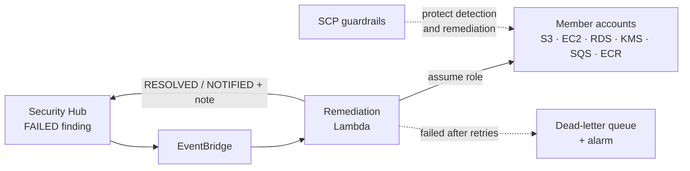

## 👋 About

I build and run **AWS and Kubernetes platforms that are secure by default and quiet to operate**: multi-account AWS and EKS in Terraform and CDKTF, GitOps delivery, private cluster access, and the security controls around all of it.

**11+ years** in software and production systems. I started with ten years of backend engineering, including payment and banking systems, which helps when an incident crosses from the cluster into the application code. I hold an **MSc in Information Technology and Cyber Security** (University of Belgrade) and I am a **doctoral student** there, researching machine learning for network attack detection.

## 🛠️ What I work on

- **Kubernetes on AWS:** EKS fleets, version upgrades across many clusters, Karpenter, Cilium, add-on lifecycle
- **Infrastructure as code:** Terraform and CDKTF (TypeScript) for multi-account AWS, reviewed and applied from CI
- **Delivery:** GitOps with Argo CD and Flux, Helm, GitHub Actions with OIDC and in-cluster runners for private EKS APIs
- **Cloud security:** Security Hub and GuardDuty remediation, service control policies, SSO groups mapped to Kubernetes RBAC, TLS / mTLS
- **Observability:** Prometheus, Grafana, Mimir, Loki, Tempo and Alloy, alerting that a person can act on

## ⭐ Featured: Security Hub auto-remediation

<a href="https://github.com/aleksandar-rakic/aws-security-hub-auto-remediation"><b>aws-security-hub-auto-remediation</b></a> fixes failed AWS Security Hub controls across an AWS Organization within seconds of detection and writes every decision back onto the finding. Service control policies stop accounts from switching detection or remediation off.

<table>
<tr>
<td width="50%" valign="top">

**What it covers**

- 16 Security Hub controls: public S3 and snapshots, open admin ports, IMDSv2, TLS-only buckets, encryption, key rotation
- GuardDuty response: isolate a compromised instance and keep forensic snapshots
- Cross-account through one least-privilege member role

</td>
<td width="50%" valign="top">

**Why it is safe to run**

- Dry run by default, per-resource opt-out tag
- Checks before acting: no IMDSv2 switch while IMDSv1 is still used, no emptied default group while it is attached
- 58 Python tests (moto) and Terraform tests, no AWS account needed

</td>
</tr>
</table>

## 📌 Projects

| Project | What it shows | Stack |
|:--|:--|:--|
| [**aws-security-hub-auto-remediation**](https://github.com/aleksandar-rakic/aws-security-hub-auto-remediation) | Event-driven remediation of Security Hub findings with SCP guardrails, an operations runbook and safe rollout |    |
| [**eks-private-api-github-runners**](https://github.com/aleksandar-rakic/eks-private-api-github-runners) | Taking the EKS API private without breaking CI: OIDC for AWS, in-cluster runners for Kubernetes, a bootstrap window for new clusters |    |
| [**cyber-attack-dataset-arp-syn-ping-flood**](https://github.com/aleksandar-rakic/cyber-attack-dataset-arp-syn-ping-flood) | Rebuilding a published network-attack dataset: original units recovered, leakage-free split, baselines |    |
| [**wordpress-malware-persistence-case-study**](https://github.com/aleksandar-rakic/wordpress-malware-persistence-case-study) | Incident response write-up: a self-restoring WordPress infection, its persistence chain, defanged indicators |   |

## 🧰 Tech stack

| Area | Tools |
|:-----|:------|
| **Cloud and Kubernetes** | AWS (multi-account, Organizations), EKS, Helm, Karpenter, Cilium, Docker, Linux |
| **Infrastructure as code** | Terraform, CDKTF (TypeScript), Terraform tests, tflint |
| **Delivery** | Argo CD, Flux, GitHub Actions, Actions Runner Controller |
| **Security** | Security Hub, GuardDuty, SCPs, IAM and IAM Identity Center, Kubernetes RBAC, TLS / mTLS |
| **Observability** | Prometheus, Grafana, Mimir, Loki, Tempo, Grafana Alloy |
| **Data and messaging** | Kafka (Strimzi), Aurora PostgreSQL, Valkey / Redis |
| **Languages** | Python, TypeScript, Bash, PHP |

## 🔬 Research and open data

- **Cyber Attack Dataset: ARP, SYN, PING Flood (v3).** One 53-minute lab capture of 439,171 frames in original Wireshark units, with a chronological train/test split and the raw attack packets. [Kaggle](https://www.kaggle.com/datasets/aleksandarraki/cyber-attack-dataset-arp-syn-ping-flood) · DOI [10.34740/kaggle/ds/5620663](https://doi.org/10.34740/kaggle/ds/5620663)
- **Detection of ARP spoofing, SYN and PING flood attacks using machine learning models.** Info M, 2024. [Paper](https://infom.fon.bg.ac.rs/index.php/infom/article/view/2678)
- **Detecting ransomware applying machine learning algorithms.** With D. Simić. SYM-OP-IS 2024. DOI [10.24867/symopis-2024-51-024](https://doi.org/10.24867/symopis-2024-51-024)

## 💬 Talk to me about

Running EKS at scale without drama · moving clusters to private endpoints · turning security findings into automation · ML for intrusion detection

